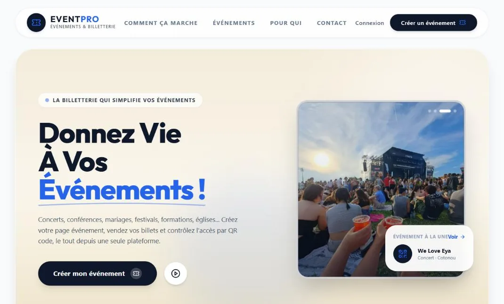
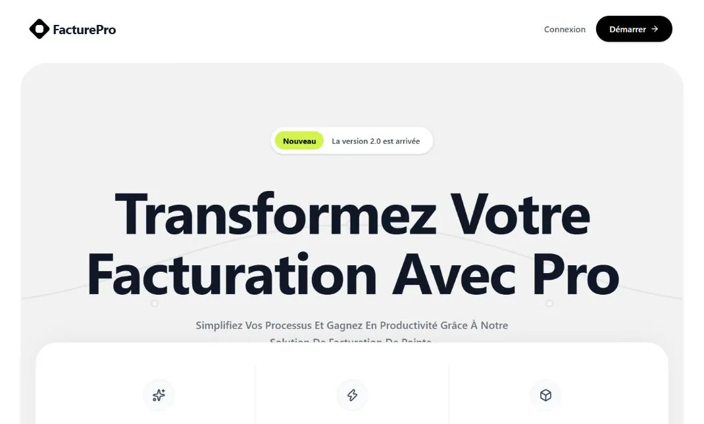
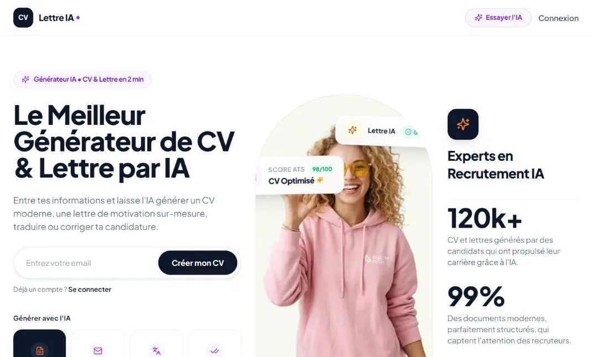
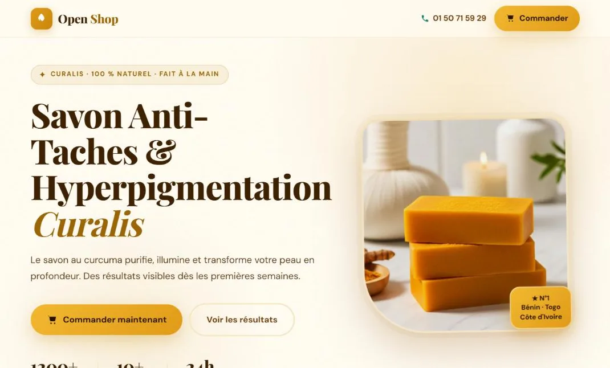
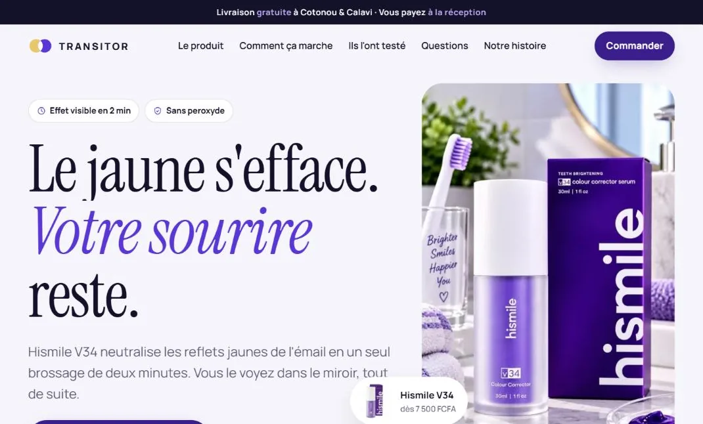
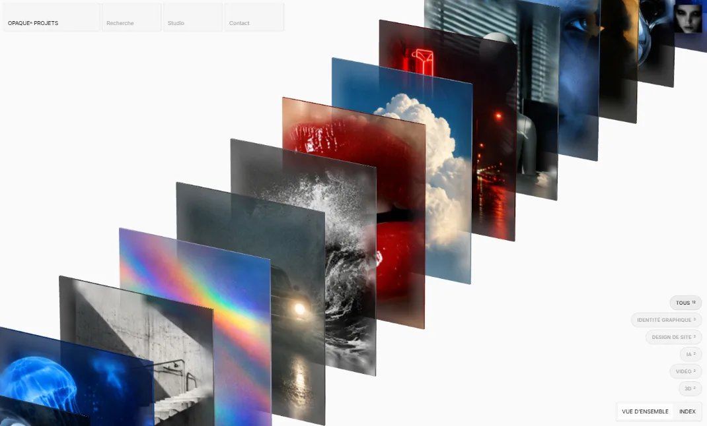

<a href="https://portfolio2-0-flame-ten.vercel.app/">
  <picture>
    <source media="(prefers-color-scheme: dark)" srcset="assets/header-dark.svg">
    
  </picture>
</a>

 

Je conçois et je code des sites et des produits web, de la première maquette à la mise en ligne. Étudiant en sécurité informatique à l'IFRI (Université d'Abomey-Calavi), je construis des interfaces vivantes sans oublier ce qu'il y a dessous : des données protégées et un code qui tient.

 

### Projet phare

  

### Sélection

<table>
  <tr>
    <td width="50%" valign="top">
      
       <b>EventPro</b> · billetterie bilingue avec paiement Mobile Money
       Next.js · Supabase · 142 utilisateurs inscrits
    </td>
    <td width="50%" valign="top">
      
       <b>GSCM</b> · factures, clients et suivi des paiements
       Next.js · Supabase · en cours
    </td>
  </tr>
  <tr>
    <td width="50%" valign="top">
      
       <b>FactorCV</b> · CV et lettres de motivation assistés par IA
       Next.js · Supabase · chef de projet
    </td>
    <td width="50%" valign="top">
      
       <b>Curalis</b> · boutique en ligne de produits naturels
       HTML · CSS · JavaScript · Supabase
    </td>
  </tr>
  <tr>
    <td width="50%" valign="top">
      
       <b>Hismile V34</b> · page produit e-commerce
       HTML · CSS · JavaScript · Supabase
    </td>
    <td width="50%" valign="top">
      
       <b>OPAQUE®</b> · portfolio de studio en pile 3D
       three.js · WebGL · concept
    </td>
  </tr>
</table>

Les autres projets, avec leur histoire, sont sur le [portfolio](https://portfolio2-0-flame-ten.vercel.app/projets).

 

### En ce moment

- Deuxième année de licence en sécurité informatique à l'IFRI.
- PMETX : de nouvelles couches de contrôle pour le code généré.
- GSCM : la facturation et le suivi des paiements.

### Outils

React · Next.js · TypeScript · Tailwind CSS · Supabase · Python · Linux · Figma

### Me joindre

[assihouroger@gmail.com](mailto:assihouroger@gmail.com) · [LinkedIn](https://www.linkedin.com/in/roger-assihou-090836332) · [Portfolio](https://portfolio2-0-flame-ten.vercel.app/) · [CV](https://portfolio2-0-flame-ten.vercel.app/cv/roger-assihou-cv.pdf)
